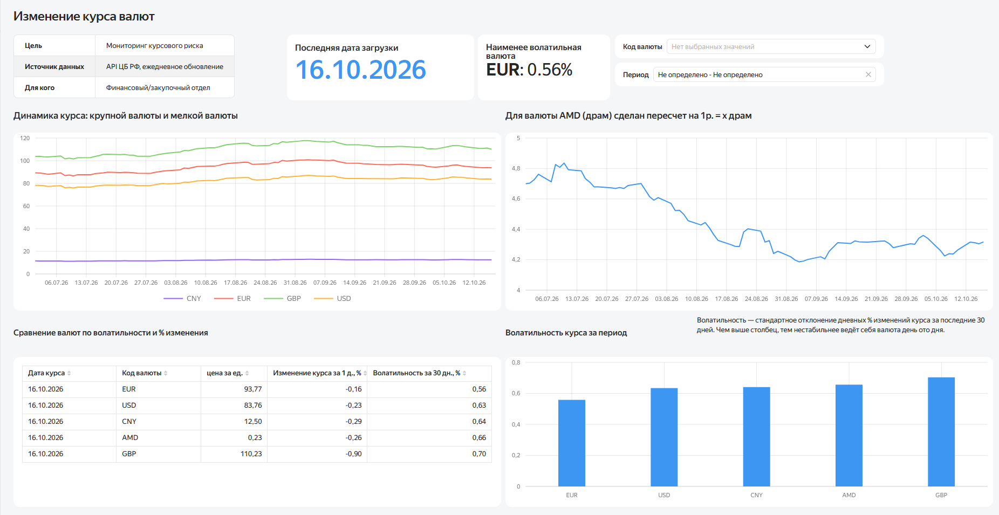
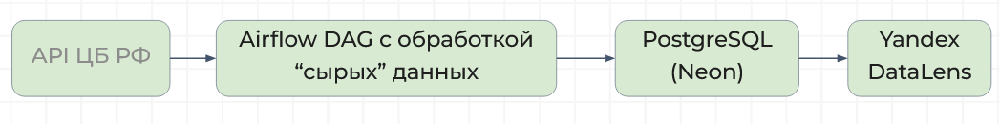
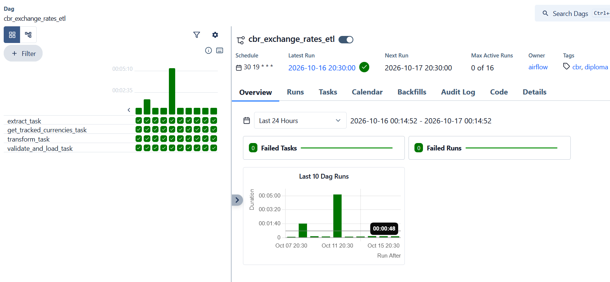

# Мониторинг курсов валют ЦБ РФ: автоматизированный ETL и дашборд

Прототип системы, которая каждый день забирает официальные курсы валют из API Банка России, хранит историю в PostgreSQL и показывает динамику и волатильность на интерактивном дашборде. Дипломный проект по программе «Аналитик данных».

**Дашборд:** [открыть в Yandex DataLens](https://datalens.ru/sq708osjqtn2b-izmenenie-kursa-valyut?state=19b2f8af56)

**Презентация и материалы проекта:** [Google Drive](https://drive.google.com/drive/folders/1OmD2XpXBJbA_mDRi9JtY9ShpE4Gxw-O1?usp=drive_link)



---

## Зачем это бизнесу

**Для кого.** Финансовый или закупочный отдел ритейлера, который закупает товары или оборудование за валюту (США, Евросоюз, Китай, Великобритания, Армения).

**Проблема.** Курс влияет на себестоимость импортных позиций. Когда курсы смотрят вручную на сайте, нет истории, нет сравнения валют между собой и нельзя сказать, в какой валюте риск выше.

**Что даёт дашборд.** Три ответа без ручной работы:

| Вопрос бизнеса | Что смотреть на дашборде | Какое решение это поддерживает |
|---|---|---|
| Куда движется курс? | График динамики и `% изменения за день` | Когда закупать, а когда подождать |
| В какой валюте риск выше? | Волатильность за 30 дней в процентах, одна шкала для всех валют | В какой валюте заключать контракт |
| Данным можно доверять? | Индикатор даты последней загрузки | Можно ли принимать решение по текущим цифрам |

Дашборд не прогнозирует курс и не считает экономию в рублях. Он даёт закупочному отделу основу для решения: историю, сравнение валют и оценку риска в одном месте.

---

## Архитектура



```
API ЦБ РФ  →  Python (extract, transform)  →  Airflow DAG  →  PostgreSQL (Neon)  →  Yandex DataLens
```

| Компонент | Что делает |
|---|---|
| API ЦБ РФ (`XML_daily.asp`) | Источник: официальные курсы, XML, без авторизации |
| Python (`requests`, `xml.etree`) | Забирает XML за нужную дату, приводит типы, считает курс за 1 единицу валюты |
| Apache Airflow 3 (Docker) | Запускает загрузку каждый день в 19:30 МСК, перезапуски и догрузка истории |
| PostgreSQL (Neon, облако) | Хранилище: справочник валют, факты курсов, SQL-вьюха с метриками |
| Yandex DataLens | Дашборд поверх вьюхи, фильтры по валюте и периоду |

Состав папки:

```
diploma/
├── cbr_currency_transform.py   # extract_cbr_rates, transform_cbr_rates (без зависимости от Airflow)
└── cbr_currency_etl.py         # DAG: расписание, задачи, запись в БД
```

Логика разделена на два файла сознательно. Функции работы с API ничего не знают про Airflow, поэтому их можно запускать и проверять отдельно.

---

## Структура базы данных

Схема «измерение и факты»: `dim_currency` хранит справочник, `fact_exchange_rate` хранит ежедневные наблюдения.

```sql
CREATE TABLE dim_currency (
    currency_id SERIAL PRIMARY KEY,
    char_code   VARCHAR(3) NOT NULL UNIQUE,
    name        TEXT,
    is_tracked  BOOLEAN NOT NULL DEFAULT false
);

CREATE TABLE fact_exchange_rate (
    rate_id       SERIAL PRIMARY KEY,
    currency_id   INT NOT NULL REFERENCES dim_currency(currency_id),
    rate_date     DATE NOT NULL,
    nominal       INT NOT NULL,
    value         NUMERIC(10,4) NOT NULL,
    rate_per_unit NUMERIC(10,4) NOT NULL,
    loaded_at     TIMESTAMP NOT NULL DEFAULT now(),
    UNIQUE (currency_id, rate_date)
);
```

- `is_tracked` задаётся вручную в базе и определяет, какие валюты загружает DAG. Чтобы добавить валюту, достаточно одной SQL-команды, код менять не нужно.
- `rate_per_unit = value / nominal`. ЦБ даёт курс за разный номинал (например, за 100 единиц), без приведения к «1 единице» валюты нельзя сравнивать.
- `UNIQUE (currency_id, rate_date)` делает загрузку идемпотентной: повторный запуск за ту же дату обновляет строку и не создаёт дубль.

Отслеживаемые валюты: USD, EUR, CNY, GBP, AMD.

---

## Как работает DAG

`cbr_exchange_rates_etl`, расписание `30 19 * * *` (каждый день в 19:30 МСК, уже после публикации курса ЦБ).

```python
tracked_codes = get_tracked_currencies_task()
raw_rates     = extract_task()
transformed   = transform_task(raw_rates, tracked_codes)
validate_and_load_task(transformed, tracked_codes)
```

1. `get_tracked_currencies_task` читает из `dim_currency` валюты с `is_tracked = true`.
2. `extract_task` берёт логическую дату запуска Airflow (`ds`), переводит её в формат ЦБ и забирает курсы за эту дату.
3. `transform_task` оставляет нужные валюты и считает `rate_per_unit`.
4. `validate_and_load_task` проверяет, что пришли все отслеживаемые валюты (иначе падает с понятной ошибкой), и записывает данные в БД.

Запись устроена как upsert:

```sql
INSERT INTO fact_exchange_rate
    (currency_id, rate_date, nominal, value, rate_per_unit, loaded_at)
SELECT currency_id, %(rate_date)s, %(nominal)s, %(value)s, %(rate_per_unit)s, now()
FROM dim_currency
WHERE char_code = %(char_code)s
ON CONFLICT (currency_id, rate_date)
DO UPDATE SET
    value = EXCLUDED.value,
    rate_per_unit = EXCLUDED.rate_per_unit,
    loaded_at = EXCLUDED.loaded_at;
```

Дата берётся из логической даты запуска, а не из текущего времени. Поэтому любой прошлый запуск можно перезапустить (`Clear` в Airflow), и он загрузит курс именно за свою дату. История с `start_date = 2026-07-01` загружается автоматически благодаря `catchup=True`.



---

## Как считаются метрики

Метрики считаются в SQL-вьюхе `v_exchange_rate_stats`, дашборд только показывает результат.

```sql
CREATE VIEW v_exchange_rate_stats AS
WITH base AS (
    SELECT
        f.currency_id,
        c.char_code,
        f.rate_date,
        f.rate_per_unit,
        ROUND(
            (f.rate_per_unit - LAG(f.rate_per_unit) OVER (PARTITION BY f.currency_id ORDER BY f.rate_date))
            / LAG(f.rate_per_unit) OVER (PARTITION BY f.currency_id ORDER BY f.rate_date) * 100,
            4
        ) AS pct_change_1d
    FROM fact_exchange_rate f
    JOIN dim_currency c ON c.currency_id = f.currency_id
)
SELECT
    currency_id,
    char_code,
    rate_date,
    rate_per_unit,
    ROUND(
        STDDEV(pct_change_1d) OVER (
            PARTITION BY currency_id ORDER BY rate_date
            ROWS BETWEEN 29 PRECEDING AND CURRENT ROW
        ),
        4
    ) AS volatility_30d,
    pct_change_1d
FROM base;
```

| Поле | Что означает |
|---|---|
| `pct_change_1d` | На сколько процентов курс изменился по сравнению с предыдущим днём. Показывает направление и скорость |
| `volatility_30d` | Стандартное отклонение дневных `% изменений` за 30 дней. Показывает, насколько курс скачет изо дня в день. Чем выше значение, тем выше риск |

**Почему волатильность считается по процентам, а не по цене.** Курсы сильно различаются по масштабу: GBP стоит около 117 ₽, AMD около 0,24 ₽. Разброс в рублях для них несопоставим. Разброс дневных процентных изменений сравним у любых валют.

Для первых строк истории `pct_change_1d` и `volatility_30d` равны `NULL`, потому что сравнивать ещё не с чем.

---

## Дашборд

Дашборд собран в Yandex DataLens на двух датасетах:

- `metrics_ds` читает всю вьюху и нужен для графика динамики (важны все даты).
- `latest_snapshot_ds` отдаёт по одной последней строке на валюту. Нужен для таблицы сравнения и графика волатильности, чтобы не суммировать показатели по всем датам.

```sql
SELECT DISTINCT ON (currency_id) *
FROM v_exchange_rate_stats
ORDER BY currency_id, rate_date DESC;
```

Что на дашборде:

- Блок с описанием: цель, источник данных, для кого.
- Индикаторы: дата последней загрузки, наименее волатильная валюта.
- График динамики курса по валютам.
- Таблица «на сегодня»: курс, изменение за день, волатильность.
- Столбчатая диаграмма волатильности за 30 дней.
- Фильтры по коду валюты и по периоду.

---

## Как запустить

1. **База данных.** Создайте PostgreSQL. Для DataLens база должна быть доступна из интернета, поэтому использовалось облако Neon.
2. **Таблицы.** Выполните DDL из раздела выше, затем вьюху `v_exchange_rate_stats`.
3. **Справочник валют:**
   ```sql
   INSERT INTO dim_currency (char_code, name, is_tracked) VALUES
       ('USD', 'Доллар США', true),
       ('EUR', 'Евро', true),
       ('CNY', 'Юань', true),
       ('GBP', 'Фунт стерлингов', true),
       ('AMD', 'Армянский драм', true);
   ```
4. **Airflow.** Положите оба `.py` файла в папку `dags/diploma/`. В Airflow создайте Connection `diploma_db` (тип Postgres, host, порт, база, логин, пароль) и в поле Extra укажите `{"sslmode": "require"}`.
5. **Запуск.** Включите DAG `cbr_exchange_rates_etl`. С `start_date = 2026-07-01` и `catchup=True` история загрузится автоматически.
6. **DataLens.** Создайте подключение к базе, затем датасеты на вьюхе и соберите чарты.

Пароли и строки подключения в репозиторий не коммитятся, они хранятся в Airflow Connection.

---

## Технические заметки

- В Airflow 3.x папка `dags/` не добавляется в `PYTHONPATH` автоматически. Поэтому в начале DAG-файла путь добавляется вручную через `sys.path.insert`, иначе импорт `cbr_currency_transform` не работает.
- Зависимости между задачами строятся через передачу результатов (TaskFlow API), явные стрелки `>>` не нужны.
- `catchup=True` оставлен сознательно, чтобы история накапливалась и догонялась после пауз.

## Ограничения

- Airflow запущен в Docker на локальном компьютере, поэтому запуск по расписанию происходит, только если компьютер включён. Для постоянной работы систему нужно перенести на сервер.
- История данных небольшая, поэтому выводы о волатильности носят предварительный характер.
- Прогнозирование курса не входит в проект. Дашборд описывает прошлое и текущий риск.

## Стек

Python, Apache Airflow 3, PostgreSQL (Neon), SQL (оконные функции, CTE), Docker, Yandex DataLens.
