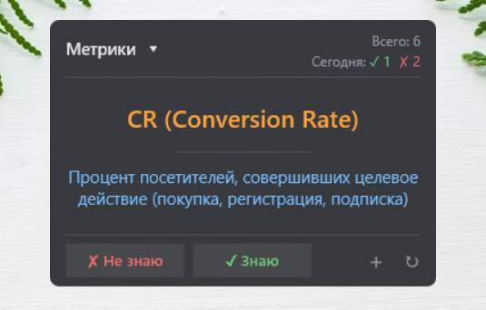
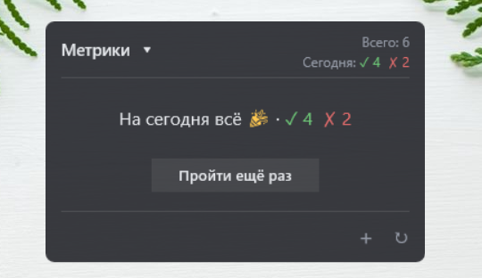

# Виджет карточек на рабочий стол

Виджет для Windows для запоминания слов, терминов, определений — чего угодно в формате
«вопрос — ответ». Карточки берутся из Google Таблицы (каждый лист — отдельная колода),
повторения идут по интервалам 1 → 3 → 7 → 30 дней. Отображает [Rainmeter](https://www.rainmeter.net/).

  

```
00:05 / вход в Windows / ↻ ──► main.py ──► Google Таблица (все листы-колоды)
                                         + progress.json ──► очередь на сегодня ──► data.inc ──► Rainmeter
✓ Знаю / ✗ Не знаю ──► Rainmeter листает сразу ──► answer.py в фоне записывает ответ в progress.json
очередь закончилась ──► main.py --local --settle ──► «На сегодня всё 🎉»
```

## Возможности

- **Колоды** — листы таблицы; выбор в выпадающем списке ▾. Новый лист появляется в списке сам после ↻.
- **Случайная сторона:** вопросом бывает то столбец A, то столбец B (в течение дня — одинаково).
- **«( показать ответ )»** — просто подсмотреть, ничего не записывает.
- **✓ Знаю** — интервал на ступень выше; **✗ Не знаю** — повтор завтра с начала.
- **Сегодня: ✓ N ✗ M** и **Всего** по текущей колоде; счётчики не сбрасываются при обновлении.
- До **20 новых карточек в день** на колоду + повторения, у которых подошёл срок.
- **«На сегодня всё 🎉»** и **«Пройти ещё раз»** — вся колода в случайном порядке, без влияния на интервалы.
- Смена карточки **по таймеру** (раз в час), если ничего не нажимать.
- Размер вопроса — по длине текста (16 / 14 / 12), вопрос — оранжевым.
- **+** — открыть таблицу на листе текущей колоды; **↻** — загрузить свежие карточки.

## Формат таблицы

Каждый лист — колода, название листа = название колоды в списке.

| A | B |
|---|---|
| *заголовок (пропускается)* | *заголовок (пропускается)* |
| serendipity | счастливая случайность |
| Retention rate | доля клиентов, оставшихся за период |

- Первая строка — заголовок, на карточках не показывается.
- Берутся только строки, где заполнены **оба** столбца; столбцы правее B игнорируются.
- Лишние пробелы и переносы строк внутри ячеек убираются.

## Интервальные повторения

```
новая ──✓──► +1 день ──✓──► +3 дня ──✓──► +7 дней ──✓──► +30 дней ──✓──► +30 …
   ▲                │               │               │               │
   └──────────── ✗ Не знаю → повтор завтра, с начала ◄─────────────┘
```

- Прогресс хранится локально в `progress.json` и привязан к **названию колоды + тексту столбца A**
  (без учёта регистра). Исправили перевод (B) — прогресс сохранится; исправили слово (A) — новая карточка.
- ⚠️ **Переименование листа** = новая колода: её прогресс начнётся заново.
- Вторая оценка одной и той же карточки за день не учитывается.

## Структура проекта

| Файл | Назначение |
|---|---|
| `main.py` | точка входа: загрузка колод → очередь на сегодня → `data.inc` → обновление скина |
| `fetch.py` | загрузка всех листов-колод и их локальная копия `data/cards.json` |
| `progress.py` | `progress.json`: интервалы карточек, счётчики по дням; защита от одновременной записи |
| `transform.py` | очередь на сегодня, «пройти ещё раз», случайная сторона, размер шрифта, переменные скина |
| `answer.py` | запись ответа по кнопкам виджета — без интернета и тяжёлых библиотек, ~0,1 с |
| `config.py` | пути (без привязки к компьютеру), права, интервалы, поиск Rainmeter через реестр |
| `check_access.py` | проверка доступа — выводит только количества карточек |
| `settings.example.json` | шаблон настроек |
| `rainmeter/FlashcardsWidget/FlashcardsWidget.ini` | скин Rainmeter |

Не хранятся в git (см. `.gitignore`): `credentials.json`, `settings.json`, `progress.json`,
`data/`, `rainmeter/FlashcardsWidget/@Resources/data.inc`, `logs/`, `.venv/`.

## Установка с нуля

### 1. Python-окружение
```
python -m venv .venv
.venv\Scripts\pip install -r requirements.txt
```

### 2. Доступ к таблице (сервисный аккаунт)
1. [Google Cloud Console](https://console.cloud.google.com) → проект → APIs & Services → включить **Google Sheets API**.
2. IAM & Admin → Service Accounts → отдельный аккаунт **без ролей** → Keys → JSON →
   сохранить в папку проекта как `credentials.json`.
3. В таблице: «Настройки доступа» → email сервисного аккаунта → **Читатель**. Общий доступ — «Доступ ограничен».

### 3. Настройки
Скопировать `settings.example.json` → `settings.json`:

| Поле | Что указать |
|---|---|
| `spreadsheet_id` | часть адреса таблицы между `/d/` и `/edit` |
| `google_account` | аккаунт, под которым кнопка «+» открывает таблицу (`authuser`) |
| `exclude_sheets` | листы, которые не являются колодами, например `["Черновик"]` |
| `new_per_day` | новых карточек в день на колоду (по умолчанию 20) |

Проверка: `python check_access.py`.

### 4. Rainmeter
1. Ссылка на папку скина (PowerShell, путь — свой):
   ```
   New-Item -ItemType Junction -Path "$env:USERPROFILE\Documents\Rainmeter\Skins\FlashcardsWidget" -Target "<папка проекта>\rainmeter\FlashcardsWidget"
   ```
2. `python main.py --no-refresh` → Rainmeter → Manage → Refresh all → `FlashcardsWidget` → Load.

### 5. Планировщик заданий
Create Task: **Run only when user is logged on**; триггеры **Daily 00:05** (без повтора — обновление
перезагружает скин и прервало бы «Пройти ещё раз») и **At log on** с задержкой 1 минута;
действие `<папка проекта>\.venv\Scripts\pythonw.exe`, аргумент `main.py`, **Start in** `<папка проекта>`;
снять «only if on AC power»; run ASAP after missed start; stop after 1 hour; без «delete it after».

## Запуск вручную

```
python main.py                  # загрузить колоды из таблицы и обновить виджет
python main.py --local          # пересобрать очередь из локальной копии, без интернета
python main.py --local --deck 2 # сделать текущей колоду №2
python main.py --no-refresh     # только записать data.inc, не трогая Rainmeter
```

## Настройка

- `settings.json` — `new_per_day`, `exclude_sheets`.
- `config.py` — `INTERVALS` (дни между повторениями).
- `transform.py` — `FONT_SIZES`, `FONT_SIZE_LONG` (размер вопроса по длине).
- `FlashcardsWidget.ini`, секция `[Variables]` — `CardMinutes` (таймер), `W`, `BtnW`, цвета
  (`ColorQuestion`, `ColorKnow`, `ColorDontKnow`…). После правки: ПКМ по виджету → Refresh skin.
- В выпадающем списке заготовлено **10 пунктов**: 11-я колода не покажется (пункты добавляются в скин по образцу `MeterMenu10`).

## Если что-то не работает

| Симптом | Причина / где смотреть |
|---|---|
| Новый лист не появился в списке | нажать ↻: смена колоды через ▾ работает по локальной копии |
| Кнопка не реагирует | Rainmeter → About → Log; значения с пробелами в `!SetVariable` должны быть в кавычках, у метра — `DynamicVariables=1` |
| Счётчики не те после полуночи | обновление в 00:05 не прошло — Планировщик, Last Run Result, `logs/widget.log` |
| Кракозябры | `.ini`/`data.inc` не в UTF-16 |
| Ошибка 403 / таблица не найдена | таблица не открыта для email сервисного аккаунта |

## Безопасность и данные

- Сервисный аккаунт читает только эту таблицу и только на чтение; прогресс пишется **локально**, не в таблицу.
- `credentials.json`, `settings.json`, `progress.json` и копия карточек — в `.gitignore`.
- В лог пишутся только служебные данные и ID карточек, без текста.
